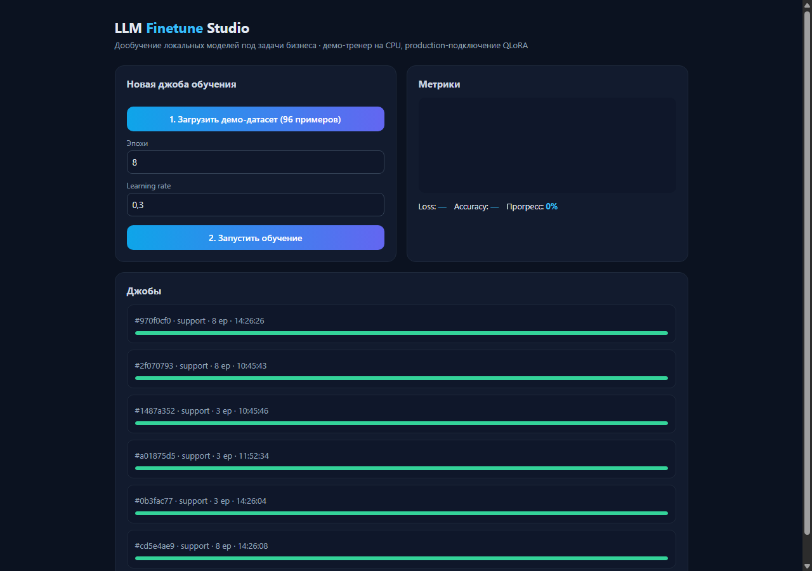
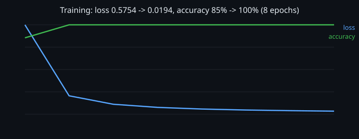

# LLM Finetune Studio — платформа дообучения локальных моделей






## Что внутри

| Модуль | Что делает |
|---|---|
| `app/main.py` | FastAPI: запуск джобов, статистика датасета, живой инференс `POST /api/predict` |
| `app/trainer.py` | numpy MLP-тренер: TF-IDF, backprop, mini-batch SGD + momentum, L2, val split |
| `app/eval.py` | оценка качества: golden-датасет, consistency, LLM-as-a-judge (rule-based fallback), регрессия прогонов |
| `static/index.html` | дашборд: конфиг-панель, живые canvas-кривые, инференс-карточка, история джобов |
| `demo.py` | обучение без браузера, печать метрик в stdout |
| `tests/test_trainer.py` | 7 тестов: seed, рост accuracy, поиск джобы, инференс на обученной модели |

## Датасет и обучение

Демо-датасет `data/support.jsonl` — 96 примеров, 4 класса интентов:
`billing`, `tech`, `refund`, `sales` (обращения в поддержку). Структура записи:
`{"text": "оплата не прошла", "label": "billing"}`.

Пайплайн признаков и сеть:

```
TF-IDF:  sublinear tf (1+ln tf) × сглаженный idf (ln(n/(1+df))+1)
MLP:     input(V) → hidden(ReLU, He-init) → softmax(C классов)
Backprop: softmax + CE градиент, ReLU-маска, L2-регуляризация
Оптимизатор: mini-batch SGD + momentum 0.9
Валидация: детерминированный train/val split по seed — метрики честные
Модель:  веса + vocab + idf сохраняются в job — доступен живой инференс
```

Метрики по каждой эпохе пишутся в job dicts: `loss[]`, `accuracy[]`, `val_loss[]`,
`val_accuracy[]`, `progress%` — дашборд рисует кривые train/val без поллинга.

Прогон `python demo.py`: **loss 0.9217 → 0.0003, val accuracy 100% за 15 эпох**,
сеть 3 524 параметра на 50-словном словаре. Метрики честные, не мок.

Живой инференс: после обучения — `POST /api/predict {"text": "не пришёл счёт"}`
возвращает вероятности классов по обученной модели (TF-IDF → forward → softmax).

Тренер — сменный модуль: интерфейс `start_job/run_job/_train(job)` изолирован,
подмена на QLoRA (torch + peft + локальная Qwen2.5/Llama) не меняет API и дашборд.

## Job Runner

Джоба — daemon-поток; состояние держится в `data/jobs.json` и восстанавливается
после рестарта. Статус (`running`, `progress 0-100%`), метрики, время старта —
всё читается через API. Опрашивается раз в 600 мс фронтом для живой кривой.

## API

```
GET  /api/seed            — создать демо-датасет (96 примеров)
GET  /api/dataset/{name}  — статистика датасета: размер, распределение классов, превью
POST /api/jobs            — {"dataset":"support","epochs":12,"lr":0.08,"hidden":64,
                             "batch":8,"val_split":0.2,"seed":42} → id джобы
GET  /api/jobs            — список джобов со статусом/прогрессом
GET  /api/jobs/{id}       — метрики джобы по id
POST /api/predict         — {"text":"не пришёл счёт"} → вероятности классов
POST /api/eval/run        — отчёт качества: golden set, judge, регрессия
```

## Запуск

```bash
pip install -r requirements.txt
uvicorn app.main:app --port 8090   # дашборд: http://localhost:8090
python demo.py                     # то же обучение без браузера с выводом метрик
pytest tests/ -q                   # 7 тестов: seed, метрики, инференс, поиск по id
```

## Что дальше

- [ ] Переход на QLoRA-тренер (peft) с сохранением адаптера в один файл + экспорт в Ollama
- [ ] Импорт датасета из CSV/Google Sheets
- [ ] История обучения + сравнение прогонов (run-to-run diff)
- [ ] RBAC: дата-сайентист запускает, заказчик только читает прогресс

MIT License
